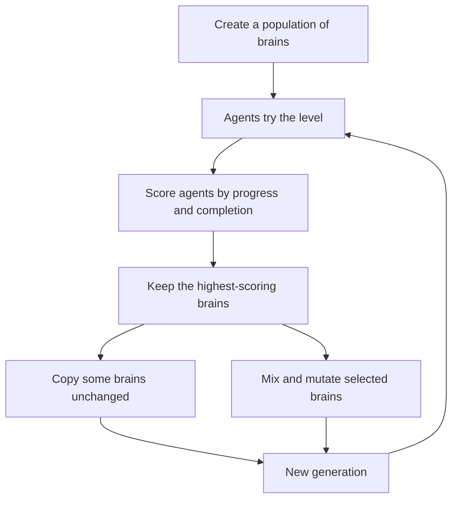
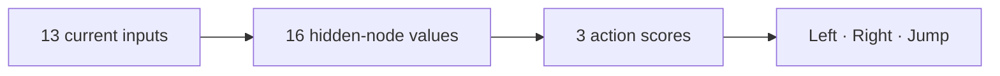
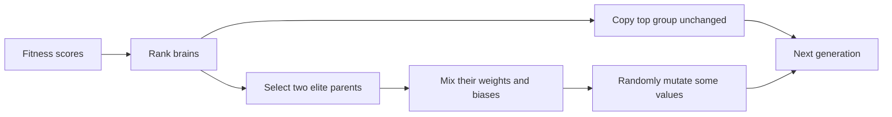

# How the Agents Learn to Reach the Goal

## A plain-language research note

### Summary

This project tests whether a population of simple agents can become better at
reaching a platform level's goal through repeated attempts. Each agent senses
its current situation, uses a small neural network to choose actions, and
receives a score based mostly on how close it is to the goal. After a
generation, the better-scoring brains are copied and used to create the next
population.

The program does **not** plan a route, remember a sequence of steps, or learn
from a human demonstration. A route can emerge when one brain's repeated
moment-to-moment decisions happen to move its agent through the level toward
the goal.

## The question this project explores

> If agents with different starting brains try the same level, can selecting
> and varying the better-scoring brains produce agents that make more useful
> decisions over generations?

Here, "learning" means **population-level improvement through evolution**.
One agent does not adjust its brain while it is playing. Instead, a whole
generation tries, the agents are scored, and their scores guide which brains
are kept or used as parents.

## The experiment at a glance

- **World:** a tile-based platform level with solid blocks, hazards, a spawn,
  and a goal.
- **Population:** 20, 24, or 30 agents, according to the selected setting.
- **One generation:** agents act for up to 15 seconds, unless all have already
  finished.
- **Brain:** 13 inputs, 16 internal nodes, and 3 action outputs.
- **Actions:** steer left or right, and request a jump.
- **Selection:** preserve the top 20% of brains (at least two), then create
  other brains by mixing and mutating the selected brains.



This diagram describes the **population cycle**. The next sections zoom in on
what one agent does during a single attempt.

## One agent's decision loop

An agent repeatedly follows the same cycle:

```text
SENSE → CALCULATE → ACT → PHYSICS CHANGES THE WORLD → SENSE AGAIN
```

During training, the simulation uses fixed physics steps of about 1/60 of a
second. At each step, the agent receives a fresh snapshot of its situation.
It does not receive one set of signals for the whole attempt.

### 1. Sense: receive 13 numbers

The 13 inputs describe the agent **right now**:

| How many | Signal | What the number means |
|---:|---|---|
| 8 | Obstacle distances | Distance to the nearest tile along 8 directions: up, down, left, right, and the 4 diagonals. Each ray reaches up to 5 tiles. |
| 2 | Goal offset | Whether the goal is to the left or right, and above or below. |
| 2 | Velocity | How fast the agent is moving horizontally and vertically, including direction. |
| 1 | Grounded state | `+1` if standing on a solid surface; `-1` if airborne. |

The obstacle readings are distances scaled between 0 and 1:

- **Near 0** means an obstacle is close in that direction.
- **Near 1** means it is far away, or no tile was detected within the ray's
  range.

The goal-offset and velocity values are scaled between -1 and +1. A negative
horizontal goal offset means the goal is to the left; a positive one means it
is to the right. Vertically, negative means above and positive means below.

The eight rays are like narrow beams—not a complete picture of the level. The
agent also does not get a sentence such as "jump over the block." It gets
numbers. The brain must turn those numbers into action scores.

### 2. Calculate: turn the numbers into three action scores

The brain has two stages of calculation:



#### Stage A: 13 inputs become 16 internal values

Each of the 16 hidden nodes receives all 13 inputs. Every node has its own
weights and bias, so each makes a different weighted mixture. A useful way to
think about this layer is as a set of 16 different "mixing bowls": each one
combines the same sensor readings in a different way, then passes one signal
forward. In neural-network terminology, a hidden layer creates an intermediate
representation of the original inputs—signals that the next layer can use to
make its output (Goodfellow et al., 2016, pp. 165–169).

$$
h_j = \tanh\left(\sum_{i=1}^{13} w_{ji}x_i + b_j\right),
\qquad j=1,\ldots,16
$$

In plain terms: multiply each sensor number by its weight, add the results and
a bias, then apply `tanh` to keep the answer between -1 and +1.

These 16 values are **not named facts**. For example, a hidden-node value of
`0.7` does not mean "70% sure there is a wall." It is simply an internal signal
that reflects how that node's particular weighted mixture responds to the
current inputs. We did not hand-label node 4 as "wall detector" or node 9 as
"jump detector." The values only become useful as parts of the complete
input-to-action calculation.

#### Stage B: 16 internal values become 3 action scores

Each output separately combines the same 16 hidden values, using its own
weights and bias:

$$
y_k = \tanh\left(\sum_{j=1}^{16} v_{kj}h_j + c_k\right),
\qquad k \in \{\text{left},\text{right},\text{jump}\}
$$

The result is three scores between -1 and +1: one for left, one for right, and
one for jump. They are **not** probabilities, and the network does not contain
a written rule like "if a block is close, jump." The scores come from applying
the brain's current settings to the current sensor readings.

#### What do the weights, bias, and `tanh` do?

- **Weight:** controls how much one input or internal value affects a sum. A
  positive weight pushes the sum in the signal's direction; a negative weight
  pushes it the other way.
- **Bias:** an extra offset added to the sum. It can shift a node's response
  even when its inputs are small. In textbook notation, weights form the
  transformation and the bias is added before the activation
  (Goodfellow et al., 2016, p. 168).
- **`tanh`:** squashes any sum into the range -1 to +1. It is not a yes/no
  switch; values between the endpoints are possible. For example,
  `tanh(-2) ≈ -0.96`, `tanh(0) = 0`, and `tanh(2) ≈ 0.96`: a strong negative
  signal, a neutral signal, and a strong positive signal. Chapter 6 discusses
  `tanh` as a zero-centered activation and explains that it saturates toward its
  endpoints (Goodfellow et al., 2016, pp. 191–192).

### Why have two stages, and why use `tanh` between them?

If both stages only added weighted numbers, the two stages would collapse
mathematically into one weighted calculation. The intermediate layer would not
give the network a richer kind of input-to-action relationship. A nonlinear
activation such as `tanh` changes that: the first stage can reshape sensor
combinations, and the output stage can combine those reshaped signals into
actions. In simple terms, the hidden layer gives the brain a way to respond to
combinations of clues, not just one straight weighted sum of the raw sensors
(Goodfellow et al., 2016, pp. 168–170).

This does **not** mean we programmed hidden nodes to recognize specific
situations. Their roles depend on their weights, and those weights start
random. It also does not mean `tanh` itself decides whether to jump. It
provides a bounded, graded signal; the game later applies the jump threshold.

One useful nuance from the textbook: `tanh` can saturate near -1 or +1, where
its output changes little as its input changes. Chapter 6 notes that saturation
can make gradient-based training harder (Goodfellow et al., 2016, pp. 191–192).
This project does not use gradient descent: it evolves whole sets of weights
through selection and mutation. So that particular gradient difficulty does
not transfer directly, and this citation is background about the activation,
not evidence that the project uses the textbook's training method.

At the start, every weight and bias is randomly set between -1 and +1. The
first brains are therefore starting guesses. There are 275 such values:
16 × (13 input weights + 1 bias), plus 3 × (16 hidden weights + 1 bias).

### 3. Act: the game turns scores into movement

The brain suggests scores; the simulation applies them:

$$
\text{steering} = \text{right score} - \text{left score}
$$

- Positive steering accelerates right; negative steering accelerates left.
  The game adds `steering × 0.38` to horizontal velocity each physics step,
  with velocity capped between -5.2 and +5.2. The scores adjust speed; they do
  not directly select an exact speed.
- The game jumps only if the jump score is greater than `0.35` **and** the
  agent is grounded. A jump sets upward velocity to `-9.3`. Jump strength is a
  fixed game setting, not a value the brain chooses.
- Otherwise, gravity and collisions continue to affect the agent.

For example, if the scores are:

```text
left = 0.2     right = 0.8     jump = 0.6
```

then `right - left = 0.6`, so the game accelerates the agent to the right. The
jump score is above `0.35`, so it jumps if it is grounded. After movement and
physics update its position and speed, the simulation takes a new snapshot and
the brain calculates new scores.

The brain's weights did not change in this example. The **situation** changed,
so the same brain may give different scores next time.

## How scores turn into a new generation

### Fitness: what counts as a better attempt?

While an agent is active, its score is recalculated from how far it is from
the goal:

$$
\text{fitness}
=
\text{starting distance}
-
\text{current distance}
-
0.1 \times \text{elapsed seconds}
$$

Getting closer generally raises the score; taking longer slightly lowers it.
Reaching the goal adds a 1000-point bonus.

**Important:** this program does not save the closest square the agent ever
visited or reward each step of a route separately. Its score reflects the
agent's current distance when the score is updated, plus the time penalty and
any completion bonus. When the generation ends, the final scores are used to
rank the brains.

An attempt ends when the agent reaches the goal, hits a hazard, leaves the
playable area, or the generation's time runs out. If all agents finish sooner,
the generation ends sooner too.

### Selection, crossover, and mutation

At the end of a generation:

1. The simulation ranks all agents by fitness.
2. It copies the top 20% of their brains unchanged (at least two brains). These
   are the **elite** brains.
3. To make the rest of the population, it chooses two brains from the elite
   group.
4. For each value in a new brain, it copies that value from one parent or the
   other at random. This is **crossover**.
5. Each value then has a 13% chance of receiving a random adjustment. This is
   **mutation**; changed values are kept between -5 and +5.

The elite group is the parent pool; an individual inside that pool is chosen
at random, rather than receiving another fitness-weighted selection. The new
generation starts at the current spawn point and attempts the current level.



No step tells evolution which exact weight was helpful. The program scores the
**whole attempt**. Higher-scoring brains are kept or become parents, while
random changes introduce new variations. This is why the process is often
described as **trial and selection**.

## How can a route emerge?

The brain is not constructing a map or writing down a list like:

```text
move right → jump → land on platform → jump again → reach goal
```

Instead, at every step it applies its weights to the current sensor readings.
As the agent moves, those readings change, and the brain's action scores can
change too. Over generations, selection may preserve brains whose ongoing
responses tend to move agents closer to the goal and avoid ending the attempt
early.

If one of those brains repeatedly makes useful decisions in sequence, the
agent's physical trajectory through the level looks like a route. The route is
the **result of many local decisions plus the physics**, not a stored path the
agent planned ahead of time.

```text
current position + current motion
                 ↓
      sensor snapshot (13 numbers)
                 ↓
       fixed brain (its weights)
                 ↓
        left / right / jump scores
                 ↓
          physics moves agent
                 ↓
          next position and snapshot
                 └─────────── repeats
```

Evolution may improve how often a population reaches the goal, but success is
not guaranteed. The score is a simple signal, and it does not explicitly teach
the agent a particular safe route or reward the order of its intermediate
steps.

## What this model does—and does not—learn

**It does:**

- Recalculate actions from the agent's current sensor readings.
- Keep each agent's brain fixed during that agent's attempt.
- Compare agents using progress-related fitness and a goal-completion bonus.
- Carry forward some brains and create variations for the next generation.

**It does not:**

- Give the agent hand-written obstacle rules.
- Store a history of sensor readings or remember a closest visited square.
- Directly train each individual weight using an answer key or gradient.
- Guarantee that each generation is better or that a route will be found.

## Code map: where these ideas live

Only two files are needed to follow the learning mechanism:

- **[`src/game/simulation.ts`](./src/game/simulation.ts)** — Builds the 13
  sensor values (`sense`), gets action scores and applies movement
  (`updateAgent`), calculates fitness, and advances generations (`evolve`).
- **[`src/game/neuralNetwork.ts`](./src/game/neuralNetwork.ts)** — Creates
  initial random brains (`createGenome`), calculates the 16 internal and 3
  output values (`activateNetwork`), and mixes or mutates brains.

For a single decision, follow this path:

```text
simulation.ts: updateAgent
    → simulation.ts: sense
    → neuralNetwork.ts: activateNetwork
    → simulation.ts: apply steering and jump
```

Then follow `finishGeneration` → `evolve` in `simulation.ts` to see how one
generation's results affect the next.

## Bibliographic Citation

> Goodfellow, I., Bengio, Y., & Courville, A. (2016). Deep feedforward
> networks. In *Deep Learning* (pp. 163–223). MIT Press.
> [http://www.deeplearningbook.org/](http://www.deeplearningbook.org/)
